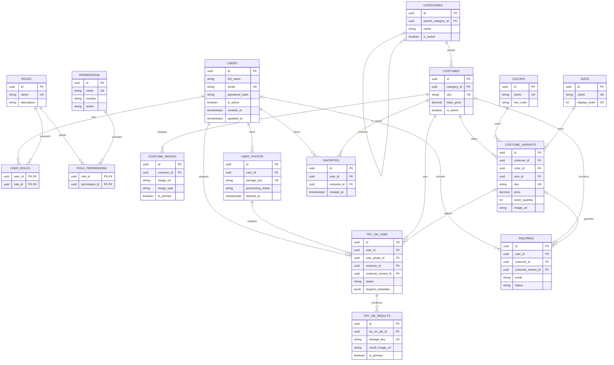

# Database Design

## Overview

PostgreSQL 16 is the system of record. Flyway owns schema changes through ordered SQL migrations; Hibernate validates the migrated schema with `ddl-auto: validate` and never creates or alters tables. Main entities use UUID primary keys, timestamps use PostgreSQL `TIMESTAMPTZ` and Java `Instant`, and prices use fixed-precision numeric columns.

The 16 application tables are `users`, `roles`, `user_roles`, `permissions`, `role_permissions`, `categories`, `costumes`, `costume_images`, `colors`, `sizes`, `costume_variants`, `user_photos`, `try_on_jobs`, `try_on_results`, `favorites`, and `inquiries`. `flyway_schema_history` is managed by Flyway, not application code.

## Tables and fields

### Identity and access control

| Table | Important fields | Keys and purpose |
| --- | --- | --- |
| `users` | `full_name`, `email`, `phone_number`, `password_hash`, `profile_image_url`, `is_active`, `created_at`, `updated_at` | UUID PK. Unique case-insensitive email index. `password_hash` is reserved for a future one-way hash, never plaintext. |
| `roles` | `name`, `description`, `created_at`, `updated_at` | UUID PK; unique name. Seeded with `SUPER_ADMIN`, `ADMIN`, and `CUSTOMER`. |
| `user_roles` | `user_id`, `role_id` | Composite PK; joins users and roles without comma-delimited values. |
| `permissions` | `name`, `description`, `module`, `action`, audit timestamps | UUID PK; unique name and `(module, action)`. Contains the 15 requested permission names. |
| `role_permissions` | `role_id`, `permission_id` | Composite PK; normalized role-permission join. |

`SUPER_ADMIN` receives all seeded permissions; `ADMIN` receives all except `USER_DELETE`; `CUSTOMER` receives no administrative permissions. No user or default password is seeded.

### Categories and catalog

| Table | Important fields | Keys and purpose |
| --- | --- | --- |
| `categories` | `name`, `description`, `image_url`, `is_active`, `parent_category_id`, audit timestamps | UUID PK; self-referencing parent FK and case-insensitive unique name. |
| `costumes` | `name`, `description`, `sku`, `category_id`, `base_price`, `is_active`, audit timestamps | UUID PK; unique SKU, category FK, and nonnegative `NUMERIC(12,2)` price. |
| `costume_images` | `costume_id`, `image_url`, `image_type`, `display_order`, `is_primary`, `created_at` | UUID PK; costume FK; constrained image type and one-primary-image partial unique index. |
| `colors` | `name`, `hex_code`, `is_active`, audit timestamps | UUID PK; case-insensitive unique name and hex format check. |
| `sizes` | `name`, `display_order`, `is_active`, audit timestamps | UUID PK; unique name and display order. |
| `costume_variants` | `costume_id`, `color_id`, `size_id`, `price`, `stock_quantity`, `sku`, `is_available`, `image_url`, audit timestamps | UUID PK; unique SKU and costume/color/size combination; nonnegative price and stock. |

Catalog images are stored outside PostgreSQL; these tables keep URLs/references only. Categories can be nested using `parent_category_id`.

### Customer photos and try-on

| Table | Important fields | Keys and purpose |
| --- | --- | --- |
| `user_photos` | `user_id`, `image_url`, `storage_key`, `original_file_name`, `mime_type`, `file_size`, dimensions, `processing_status`, `created_at`, `deleted_at` | UUID PK; unique storage key and owner FK. Nullable `deleted_at` implements soft deletion; file size and any supplied dimensions must be positive. |
| `try_on_jobs` | user/photo/costume/optional variant FKs, `status`, AI model name/version, `request_metadata`, `error_message`, `created_at`, `started_at`, `completed_at` | UUID PK; `request_metadata` is the only JSONB field. Status and timestamp ordering are constrained. |
| `try_on_results` | `try_on_job_id`, `result_image_url`, `storage_key`, `display_order`, `is_primary`, `created_at` | UUID PK; job FK, unique storage key, and one-primary-result partial unique index. Result image bytes remain external. |

Try-on states are `PENDING`, `PROCESSING`, `COMPLETED`, `FAILED`, and `CANCELLED`. The timestamps represent job lifecycle progress without placing model outputs in PostgreSQL.

Uploaded images must be kept in private object storage. URL/storage-key fields are references, not permission to expose the underlying file. Upload authorization and signed-URL generation are outside this phase.

### Favorites and inquiries

| Table | Important fields | Keys and purpose |
| --- | --- | --- |
| `favorites` | `user_id`, `costume_id`, `created_at` | UUID PK; unique `(user_id, costume_id)` prevents duplicate favorites. |
| `inquiries` | optional user/costume/variant FKs, customer name/email/phone/message, `status`, audit timestamps | UUID PK; nullable account and catalog relationships support guest inquiries. Status is constrained to `NEW`, `CONTACTED`, `IN_PROGRESS`, `COMPLETED`, or `CANCELLED`. |

## Column dictionary

Every entity table has an `id UUID` primary key. Every `created_at` is an immutable creation instant; `updated_at` is maintained by JPA for audited records. The migration also supplies timestamp defaults for inserts that bypass JPA.

| Table | Column meanings |
| --- | --- |
| `users` | `full_name` display name; `email` normalized contact/login identifier; `phone_number` optional contact number; `password_hash` BCrypt credential hash; `profile_image_url` external image reference; `is_active` account enablement flag; `created_at`, `updated_at` audit instants. |
| `roles` | `name` stable unique role code; `description` human-readable meaning; audit instants. |
| `user_roles` | `user_id` assigned account; `role_id` assigned role. The pair is the primary key. |
| `permissions` | `name` unique permission code; `description` explanation; `module` domain area; `action` operation within the module; audit instants. |
| `role_permissions` | `role_id` granted role; `permission_id` granted permission. The pair is the primary key. |
| `categories` | `name` category label; `description` details; `image_url` external category-image reference; `is_active` catalog availability; `parent_category_id` optional parent; audit instants. |
| `costumes` | `name` catalog name; `description` product details; `sku` unique stock identifier; `category_id` owning category; `base_price` nonnegative default price; `is_active` catalog availability; audit instants. |
| `costume_images` | `costume_id` owning costume; `image_url` external product-image reference; `image_type` constrained image role; `display_order` nonnegative presentation order; `is_primary` primary-image marker; `created_at` creation instant. |
| `colors` | `name` color label; `hex_code` six-digit web color; `is_active` selection availability; audit instants. |
| `sizes` | `name` size label; `display_order` nonnegative unique presentation order; `is_active` selection availability; audit instants. |
| `costume_variants` | `costume_id`, `color_id`, `size_id` define the unique combination; `price` nonnegative variant price; `stock_quantity` nonnegative inventory; `sku` unique variant identifier; `is_available` sales availability; `image_url` optional external variant image; audit instants. |
| `user_photos` | `user_id` owner; `image_url`, `storage_key` private-storage references; `original_file_name`, `mime_type`, `file_size` uploaded-file metadata; `image_width`, `image_height` optional positive dimensions; `processing_status` metadata-processing state; `created_at` creation instant; `deleted_at` soft-delete instant. |
| `try_on_jobs` | `user_id`, `user_photo_id`, `costume_id` source references; `costume_variant_id` optional selected variant; `status` lifecycle state; `ai_model_name`, `ai_model_version` execution metadata; `request_metadata` flexible JSONB request context; `error_message` failure detail; `created_at`, `started_at`, `completed_at` lifecycle instants. |
| `try_on_results` | `try_on_job_id` parent job; `result_image_url`, `storage_key` external result references; `display_order` nonnegative presentation order; `is_primary` main result marker; `created_at` creation instant. |
| `favorites` | `user_id` owner; `costume_id` favorited item; `created_at` creation instant. |
| `inquiries` | nullable `user_id` account when authenticated; nullable `costume_id` and `costume_variant_id` subject; `customer_name`, `email`, `phone_number` contact details; `message` inquiry text; `status` contact workflow state; audit instants. |

## Relationships and delete behavior

- Users and roles are many-to-many through `user_roles`; roles and permissions are many-to-many through `role_permissions`.
- A category can contain many costumes and child categories. A costume belongs to one category and can have many images and variants.
- A variant belongs to one costume, color, and size. The unique triple prevents duplicate combinations.
- A user owns many photo records and try-on jobs. A photo, costume, or optional variant can be used in multiple jobs. A job can produce multiple results.
- A user can favorite a costume once. An inquiry may have no user (guest) and may optionally reference catalog items.
- Join rows cascade when a joined parent is deleted; try-on results cascade with their job; favorites cascade with user/costume.
- Category parent, costume category/variant catalog references, user photos, and try-on source references restrict physical deletion to protect historical data.
- Optional variant references on try-on jobs and inquiries are set null on variant deletion. Inquiry user/catalog references are set null to retain contact history.
- Uploaded photos use `deleted_at` soft deletion. User deactivation (`is_active`) and photo soft deletion are preferred over deleting records still referenced by history.

Retention periods and physical account-deletion rules require product/legal decisions before production.

## Keys and indexing

Unique constraints/indexes cover role/permission names, case-insensitive user emails and category/color names, costume and variant SKUs, size ordering, variant combinations, storage keys, favorite pairs, and primary images/results. Foreign keys and commonly filtered values have indexes, including parent IDs, category and costume lookup, ownership, status/time histories, and inquiry email.

Lowercase name indexes support case-insensitive lookup. Full-text search is not introduced.

## Migration sequence

| Version | Migration | Contents |
| --- | --- | --- |
| V1 | `V1__create_users_and_roles.sql` | users, roles, user-role join, initial roles |
| V2 | `V2__create_permissions_and_seed_access_control.sql` | permissions and join, permission and mapping seeds |
| V3 | `V3__create_categories.sql` | categories and parent relationship |
| V4 | `V4__create_costumes_and_images.sql` | costumes and product-image references |
| V5 | `V5__create_colors_sizes_and_costume_variants.sql` | colors, sizes, and variants |
| V6 | `V6__create_user_photos.sql` | private uploaded-photo metadata and soft-delete timestamp |
| V7 | `V7__create_try_on_jobs_and_results.sql` | job lifecycle and external result references |
| V8 | `V8__create_favorites.sql` | unique user/costume favorites |
| V9 | `V9__create_inquiries.sql` | guest-capable customer inquiries |

## Entity relationship diagram

